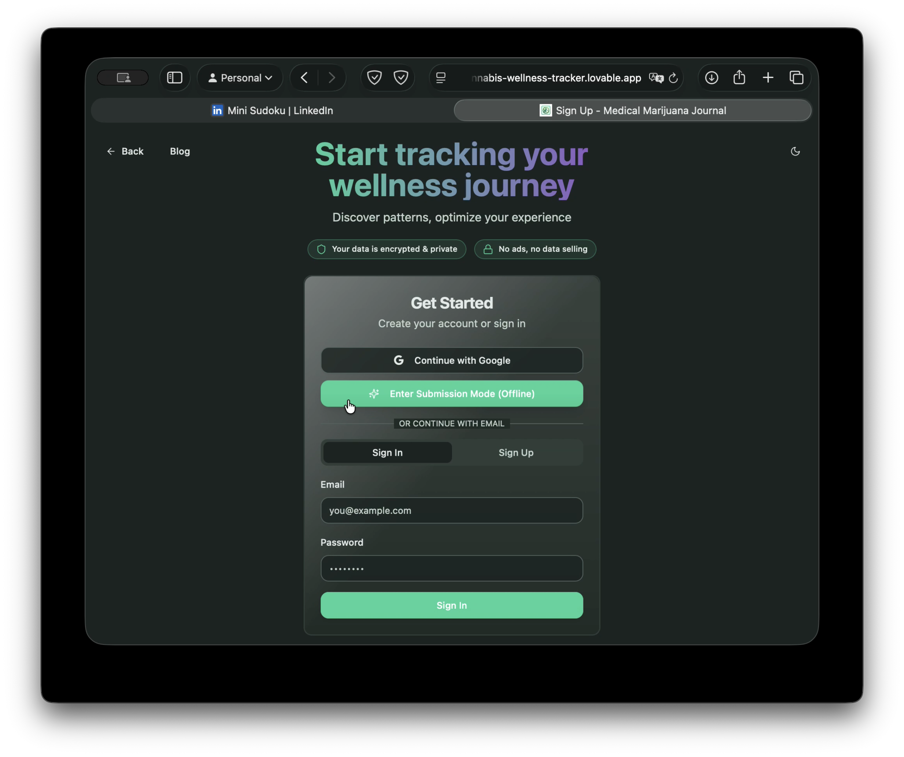
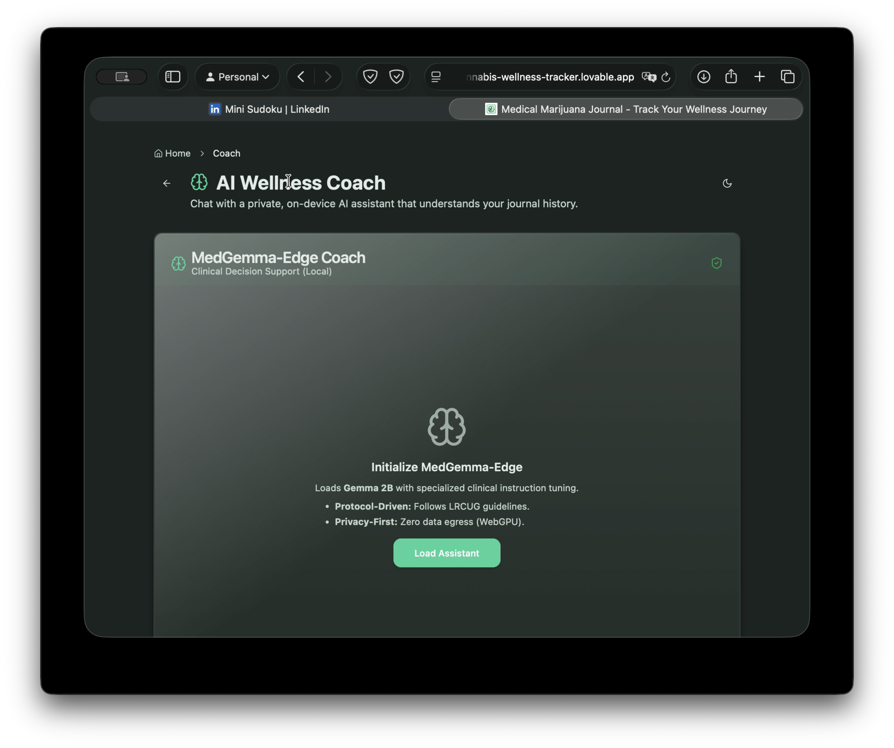
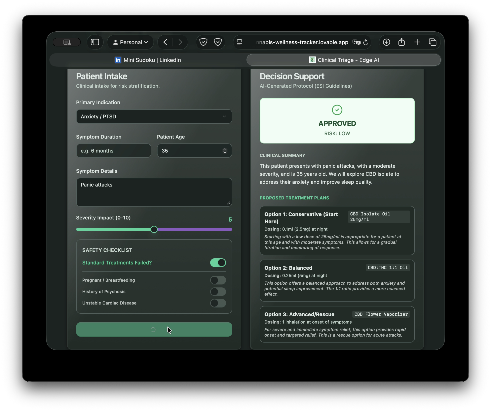
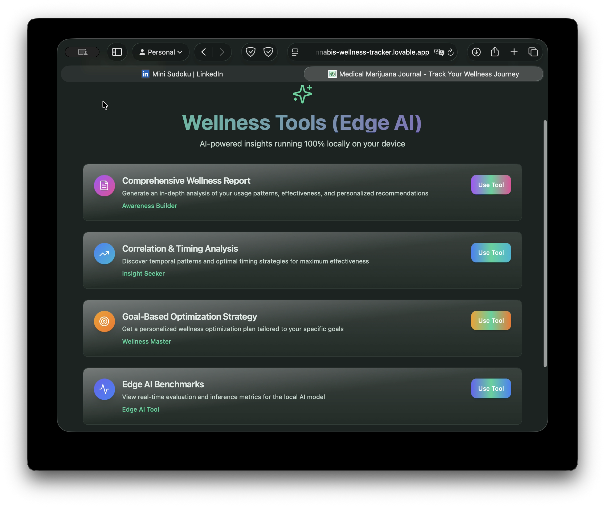
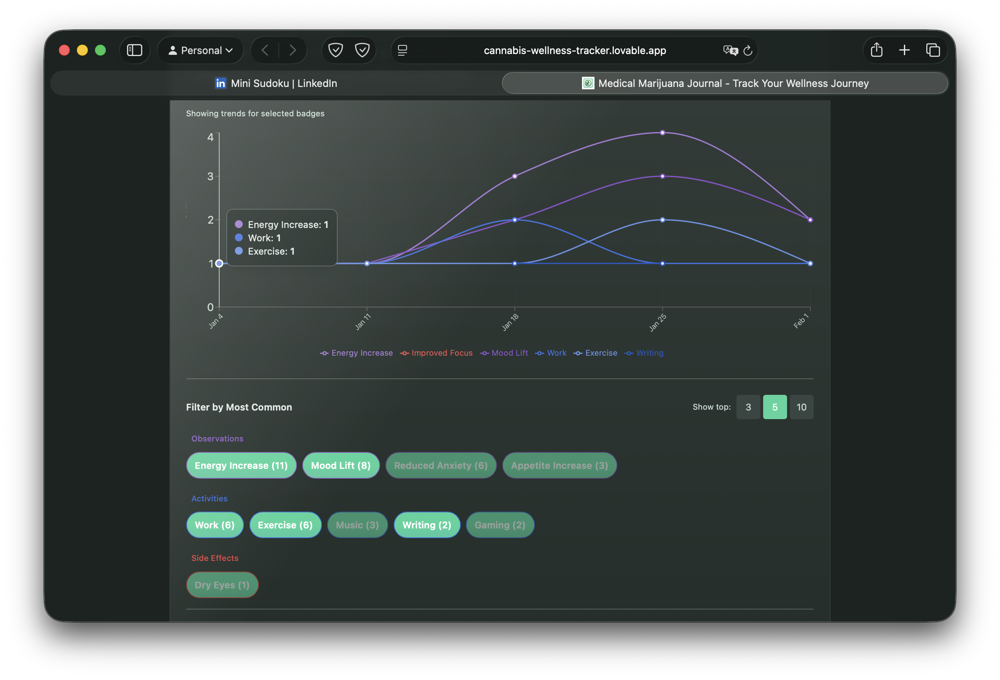

# Cannabis Wellness Tracker

<div align="center">
  
  <h3>Encrypted cloud app with a local AI brain</h3>
  <p>
    Privacy model: client‑side keys, encrypted cloud storage, local‑only AI. The database sees ciphertext; the model runs on your device.
  </p>
  <a href="https://cannabis-wellness-tracker.lovable.app">View Live Demo</a>
</div>

---

<details>
<summary>📁 <b>Archived: MedGemma Impact Challenge / Judges Information</b></summary>

<br>

> **Note:** This project was developed as a specialized submission for the **MedGemma Impact Challenge** (Edge AI Track & Main Track).

* **Full Submission Documentation:** [SUBMISSION.md](./SUBMISSION.md)
* **EU AI Act Compliance Scaffold:** [AI_QMS.md](./AI_QMS.md)
* **Local Media Directory:** [`Media/`](./Media)

#### 📝 Offline Reviewer Mode (Evaluation Guide)
To facilitate testing without any backend setup:
1. Launch the app (`http://localhost:8080`).
2. On the Authentication page, click the green **"Enter Submission Mode (Offline)"** button.
3. Navigate to **"Private AI Coach"** to initialize the Gemma-2-2B engine.
4. Navigate to **"Settings"** -> **"Clinical Portal"** to test the Clinician-Patient linking flow (use code `000000` in demo).

</details>

---

Technically, Cannabis Wellness Tracker is an encrypted cloud app with a local AI brain: Supabase holds only encrypted journals, while all MedGemma‑style reasoning and triage happen in your browser.

## 🧠 Edge AI Architecture

### The Case for Edge AI in Medical Cannabis
Medical cannabis patients handle extremely sensitive health and substance-use data. Privacy is not just a feature; it is a clinical requirement for honest journaling and effective shared decision-making. Our platform demonstrates that complex medical reasoning can be decentralized, preserving patient dignity while enabling professional oversight.

### 🛡️ Privacy and architecture
Cannabis Wellness Tracker is built as a local‑first web app with encrypted cloud sync. Your journal entries are encrypted in the browser using keys derived from your passphrase before they are sent to Supabase, and the database only stores ciphertext plus minimal operational metadata. The app never sends your passphrase or raw encryption keys to the server, and all analytics shown in the UI (trends, effectiveness scores, risk flags) are computed from data decrypted locally on your device.

For clinical decision support, the Gemma‑2B model and the cannabinoid guideline knowledge base run entirely client‑side via WebLLM/WebGPU, so MedGemma‑style reasoning stays on your device rather than calling out to a hosted LLM API. This is best described as encrypted cloud storage plus a local model, not a fully “serverless” system: we still rely on Supabase for account management and encrypted data sync, but model inference and guideline retrieval never leave your browser.

### 🏗️ Technical Implementation
1.  **Engine:** Powered by `@mlc-ai/web-llm` utilizing the `gemma-2-2b-it-q4f16_1-MLC` quantized model.
2.  **Instruction Tuning (Simulated):** We implement **In-Context Learning (ICL)** via a rigorous System Persona and Clinical Metric injection. This forces the general-purpose Gemma model to adopt a strict "Clinical Decision Support" role.
3.  **Deterministic Feature Engineering:** Raw user logs are pre-processed into high-signal clinical metrics (e.g., "Dose Drift", "Adherence Velocity") *before* LLM inference, significantly improving reasoning reliability.
4.  **Hardware Feasibility:** Optimized for consumer-grade hardware (M1/M2/M3 Macs, NVIDIA RTX, Intel Iris Xe) utilizing WebGPU for near-zero latency.

### 🎯 Task Goals & Success Metrics
1.  **Harm Reduction:** 100% interception of emergency keywords via rule-based layers before the LLM.
2.  **Automated Documentation:** Reduce clinician chart review time by 30% via AI-generated SOAP notes.
3.  **Accuracy:** Maintain a >90% factual grounding rate against the embedded guideline knowledge base.

---

## 🚀 Getting Started

### Prerequisites
*   Node.js (v18+)
*   WebGPU-capable browser (Chrome 113+, Edge 113+)

### Installation

1.  **Clone and Install:**
    ```bash
    git clone <repository-url>
    npm install
    ```

2.  **Run Development Server:**
    ```bash
    npm run dev
    ```
    The app will be available at `http://localhost:8080`.

---

## 🎥 Visual Walkthrough & Demo

### 🎬 Application Demo Video
A complete walkthrough showing zero-backend reviewer mode, client-side WebGPU Gemma-2B initialization, interactive clinical triage, and encrypted journaling.

<video src="./Media/Demo.mp4" controls width="100%" style="max-height: 520px; border-radius: 8px;">
  <p>Your browser does not support HTML5 video. <a href="./Media/Demo.mp4">View or download Demo.mp4 directly</a>.</p>
</video>

---

### 📸 Application Interface & Workflows

#### 1. Offline Reviewer & Submission Mode
Zero-backend evaluation entry point bypassing remote databases for instant offline evaluation.

<p align="center">
  
</p>

#### 2. Private AI Coach (MedGemma-Edge)
In-browser WebLLM and WebGPU initialization running Gemma-2B locally for confidential clinical decision support.

<p align="center">
  
</p>

#### 3. Clinical Triage & Decision Support
Protocol-driven patient intake and automated risk assessment using Emergency Severity Index (ESI) guidelines with tiered conservative dosing.

<p align="center">
  
</p>

#### 4. Edge AI Wellness Tools
Suite of on-device analytical tools including Comprehensive Wellness Reports, Correlation & Timing Analysis, and Edge AI Benchmarks.

<p align="center">
  
</p>

#### 5. Longitudinal Timeline Analytics
Multi-axis symptom and activity trend visualization highlighting correlation between dosage, activities, and therapeutic outcomes.

<p align="center">
  
</p>

---

## ✨ Key Features

### 🤖 Edge AI Clinical Tools
1.  **Private AI Coach:** Multi-modal analysis of effectiveness patterns grounded in clinical guidelines, running 100% on-device.
2.  **Clinician Portal:** Secure dashboard featuring multi-axis trend visualization and automated Edge AI clinical summaries.
3.  **Security Vault:** Client-side key management system for initializing and unlocking RSA-4096 encryption.
4.  **Clinical Triage System:** protocol-driven risk stratification for respiratory and inflammatory symptoms.

### 📓 Advanced Journaling
*   **Encrypted Health Logs:** Native integration of E2EE for all sensitive fields (strain, dosage, notes).
*   **Validated Scales:** Clinical-grade tracking using NRS (Pain) and GAD-7 (Anxiety) metrics.
*   **Timeline Analytics:** Adaptive visualizations showing symptom trajectory and dose-response correlation.

## 🔒 Security & Regulatory Maturity
-   **End-to-End Encrypted:** Sensitive PHI is encrypted before it leaves the browser using RSA-4096 keys.
-   **Local-First:** All AI inference is client-side via a zero-knowledge pipeline, eliminating cloud-based PHI leaks.
-   **AI Act Alignment:** Engineered to align with **EU AI Act** requirements for **High-Risk AI Systems** in healthcare, prioritizing transparency, robustness, and human-in-the-loop oversight.
-   **Audit Logs:** HIPAA-ready logging for all clinical decision support events.

## 🛡️ Disclaimer
This application is for informational purposes only. It does not provide medical advice.

---
*Cannabis Wellness Tracker — Local-First Encrypted Healthcare Platform*
